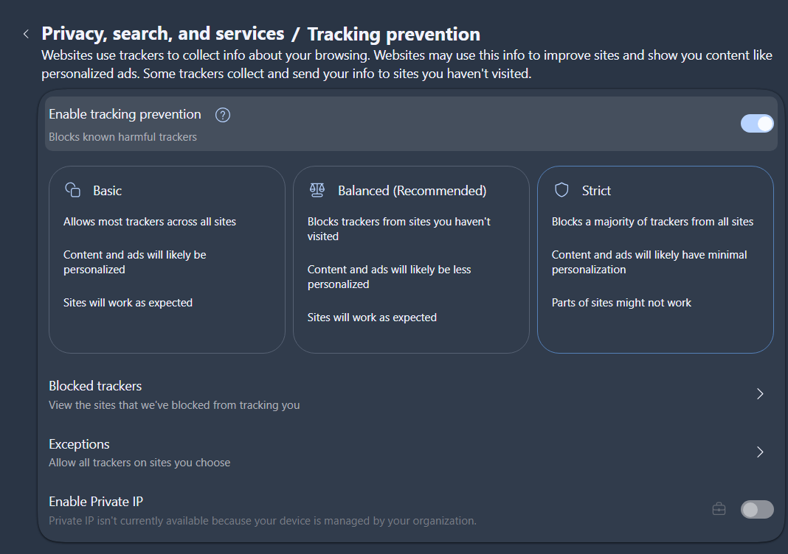
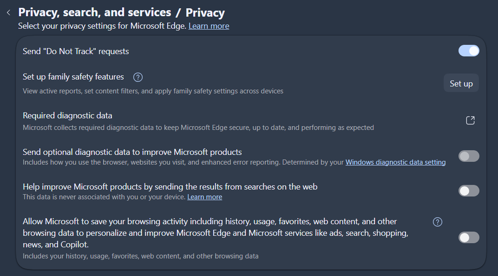
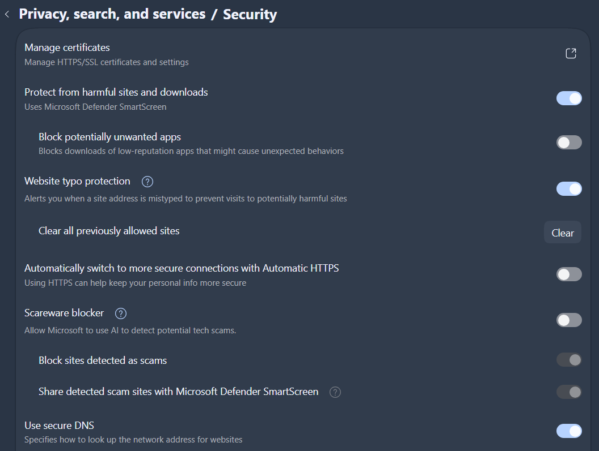
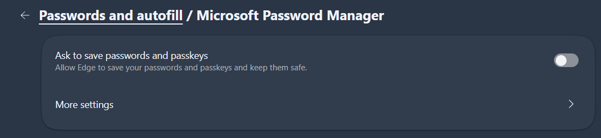
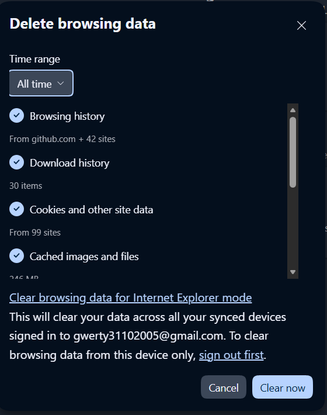
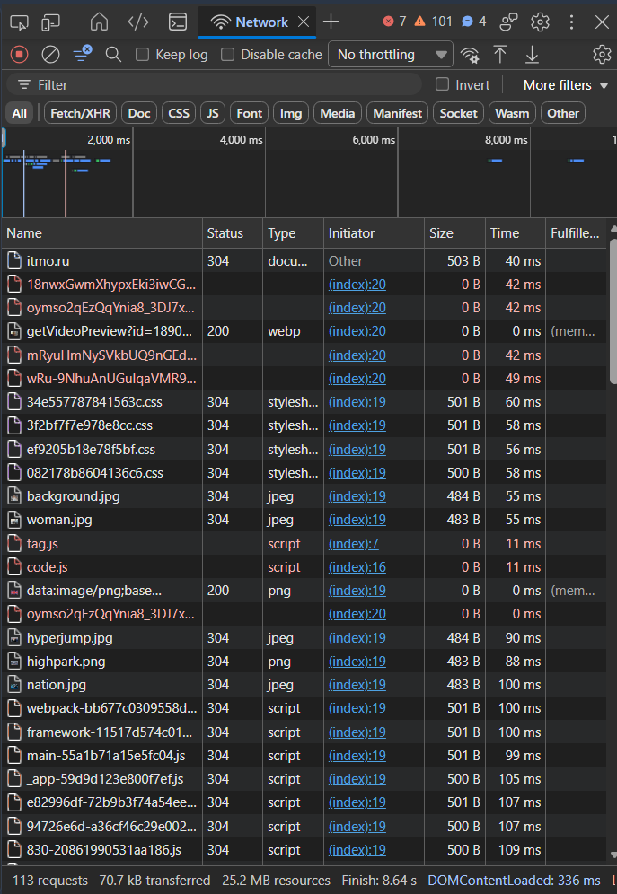
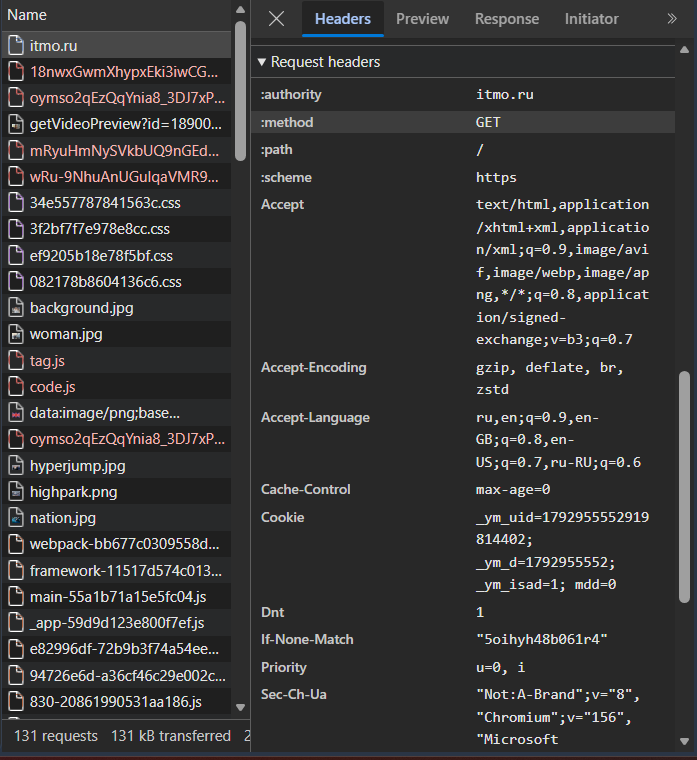
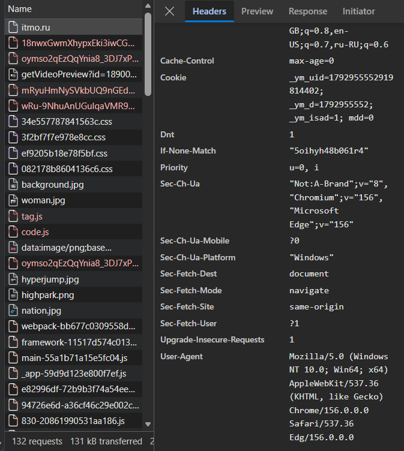
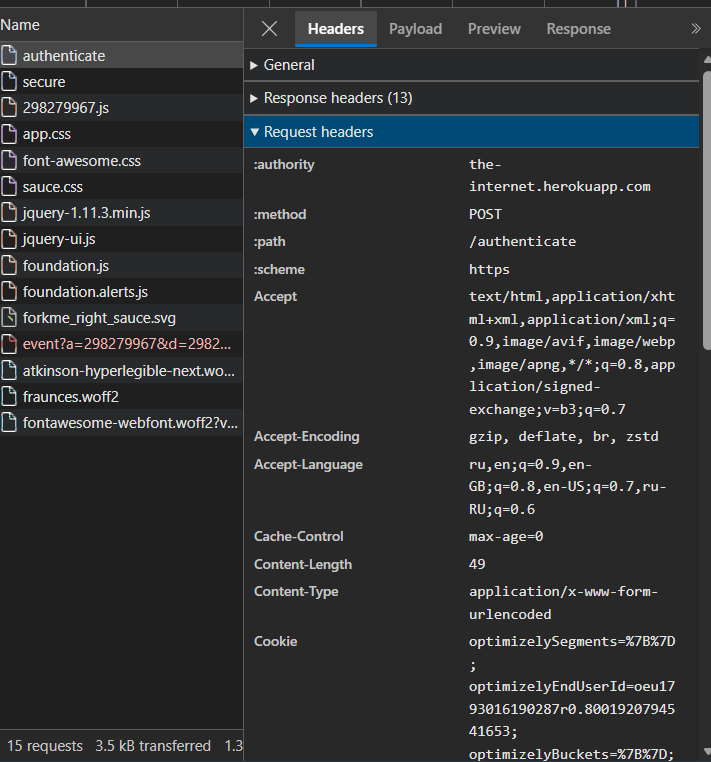
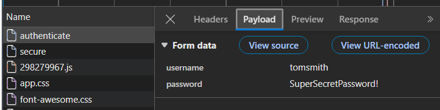

# Отчёт по лабораторной работе №7

**Федеральное государственное автономное образовательное учреждение высшего образования «Национальный исследовательский университет ИТМО»**

Дисциплина: «Информационная безопасность»
Работа 7: Безопасность браузера и анализ сетевого трафика
ФИО: Чураков А. А.
Номер группы: P3431
Год: 2026

---

## Цель работы

Изучить настройки безопасности браузера и понять, какие данные передаются между браузером и сайтом.

## 1. Настройка браузера (Microsoft Edge)

Выполненные изменения (Настройки → «Конфиденциальность, поиск и службы»):

| Настройка | Где находится | Значение |
|---|---|---|
| Предотвращение отслеживания | Tracking prevention | **Вкл., режим «Строгий» (Strict)** — блокирует большинство трекеров на всех сайтах |
| Запрет отслеживания | Privacy → Send "Do Not Track" requests | **Вкл.** (заголовок `DNT: 1`) |
| Необязательные диагностические данные, сохранение активности для персонализации | Privacy | **Выкл.** |
| Защита от вредоносных сайтов и загрузок | Security → Microsoft Defender SmartScreen | **Вкл.** |
| Защита от опечаток в адресе | Security → Website typo protection | **Вкл.** |
| Безопасный DNS | Security → Use secure DNS | **Вкл.** (DNS-over-HTTPS) |
| Сохранение паролей | Профили → Пароли → «Предлагать сохранять пароли» | **Выкл.** |
| Очистка данных | Delete browsing data (Ctrl+Shift+Del), «All time» | Удалены история, **cookie и данные сайтов (99 сайтов), кэш (246 МБ)** |

*Скриншот 1 — Tracking prevention, режим Strict*

*Скриншот 2 — Privacy, Do Not Track*

*Скриншот 3 — Security*

*Скриншот 4 — отключено сохранение паролей*

*Скриншот 5 — очистка данных*

## 2. Анализ сетевого трафика

Открыт сайт **https://itmo.ru** с инструментами разработчика (F12 → Network / «Сеть»).

**Наблюдения по списку запросов:**

- При загрузке главной страницы — **113 запросов**, все — **GET**: документ `itmo.ru`, стили `.css`, скрипты `.js`, изображения `.jpg/.png/.webp`, шрифты.
- Многие ответы со статусом **304 Not Modified** — браузер отправил условный запрос (`If-None-Match` с ETag), и сервер ответил, что ресурс не изменился (передано всего ~500 Б вместо файла). Всего передано 70,7 кБ при объёме ресурсов 25,2 МБ — работает кэширование.
- Запросы `tag.js` и `code.js` (счётчик Яндекс.Метрики) и несколько других выделены **красным, без статуса и размера** — их **заблокировала защита от отслеживания** в режиме «Строгий». То есть настройка из п. 1 реально сработала: аналитические трекеры не загрузились.
- Все запросы идут по **HTTPS**. POST-запросы на главной странице отсутствуют — они появляются при отправке форм (вход, поиск, обратная связь) и при отправке аналитики.

*Скриншот 6 — список запросов*

*Скриншот 7 — запрос itmo.ru, вкладка Headers*

**Заголовки запроса (Request Headers), которые отправляет браузер:**

| Заголовок | Что раскрывает |
|---|---|
| `User-Agent` | ОС (Windows 10 x64), браузер и его версию (Edge) |
| `Accept`, `Accept-Encoding`, `Accept-Language` | поддерживаемые форматы, сжатие, **язык пользователя** |
| `Referer` | с какой страницы пришёл пользователь |
| `Cookie` | идентификаторы сессии/отслеживания (если есть) |
| `DNT: 1` | просьба не отслеживать (результат настройки из п. 1) |
| `Cookie` (фактически) | `_ym_uid`, `_ym_d`, `_ym_isad` — идентификаторы Яндекс.Метрики, сохранённые раньше; скрипт метрики теперь заблокирован, но cookie-идентификатор всё ещё уходит на сайт |
| `If-None-Match`, `If-Modified-Since` | версия ресурса в кэше браузера (отсюда ответы 304) |
| `Sec-CH-UA*`, `Sec-Fetch-*` | бренд/платформа браузера, тип и контекст запроса |
**Заголовки ответа (Response Headers) главной страницы itmo.ru (фактические):**

| Заголовок | Значение | Смысл |
|---|---|---|
| `strict-transport-security` | `max-age=31536000; includeSubDomains` | HSTS — браузер год будет ходить только по HTTPS |
| `x-content-type-options` | `nosniff` | запрет угадывания MIME-типа |
| `referrer-policy` | `strict-origin-when-cross-origin` | на чужие сайты уходит только домен, без пути |
| `permissions-policy` | `camera=(), microphone=(), geolocation=()` | сайт запрещает себе доступ к камере/микрофону/геолокации |
| `x-xss-protection` | `1; mode=block` | устаревшая защита от XSS |
| `content-encoding` | `gzip` | ответ сжат |
| `x-geo-city-name`, `x-geo-postal-code`, `x-geo-region-name` | St Petersburg, 195213, St.-Petersburg | **сервер определил местоположение пользователя по IP-адресу** |

Вывод: даже без входа в аккаунт сайт получает тип ОС и браузера, язык, источник перехода, и по IP-адресу — город и почтовый индекс. Сайт itmo.ru корректно использует защитные заголовки (HSTS, nosniff, Referrer-Policy, Permissions-Policy).

## 3. Анализ формы входа

Использована демонстрационная форма входа https://the-internet.herokuapp.com/login, введены публичные тестовые данные (tomsmith / SuperSecretPassword!). Запрос: `POST https://the-internet.herokuapp.com/authenticate`, `Content-Type: application/x-www-form-urlencoded`, `Content-Length: 49`.

Наблюдение в DevTools (вкладка «Сеть» → запрос `POST` → Payload / «Полезная нагрузка»):

- Логин и пароль отправляются методом **POST** в **теле запроса** (`application/x-www-form-urlencoded`: `username=...&password=...` или JSON).
- **В DevTools пароль виден в открытом виде** — потому что DevTools показывает данные *до* шифрования, на стороне браузера.
- По сети данные передаются **зашифрованными протоколом TLS** (HTTPS): перехватчик в сети увидит только домен (SNI) и объём трафика, но не URL, заголовки и тело.
- Если бы форма работала по HTTP, пароль передавался бы в открытом виде и мог быть перехвачен (например, в публичном Wi-Fi).
- В ответ сервер устанавливает cookie сессии (`Set-Cookie: ...; HttpOnly; Secure`) или возвращает токен.

*Скриншот 8 — POST-запрос /authenticate, вкладки Headers и Payload*

## Ответ на вопрос: «Как чаще всего передаются данные аутентификации в современных веб-приложениях?»

Логин и пароль передаются **методом POST в теле запроса** (form-urlencoded или JSON) **по HTTPS (TLS)**. Сам пароль на клиенте обычно не шифруется и не хэшируется — конфиденциальность обеспечивает TLS, а на сервере пароль сравнивается с хэшем (bcrypt/Argon2). После успешного входа сервер выдаёт **сессионную cookie** (с флагами `HttpOnly`, `Secure`, `SameSite`) или **токен** (JWT / OAuth 2.0 access token), который дальше отправляется в заголовке `Cookie` или `Authorization: Bearer ...`, так что пароль больше не передаётся. Всё чаще применяются вход через сторонних провайдеров (OAuth 2.0 / OpenID Connect, SSO), двухфакторная аутентификация и беспарольные методы (passkeys / WebAuthn), где пароль не передаётся вообще.

## Контрольные вопросы

**1. Что такое cookies и какую угрозу конфиденциальности они могут нести?**
Cookie — небольшие данные «ключ=значение», которые сайт сохраняет в браузере и браузер автоматически отправляет обратно с каждым запросом к этому сайту. Нужны для сессий, корзины, настроек. Угрозы: сторонние (third-party) cookie рекламных и аналитических сетей позволяют отслеживать пользователя между сайтами и строить профиль интересов; кража сессионной cookie (XSS, перехват по HTTP, вредоносное ПО) даёт вход в аккаунт без пароля; долгоживущие cookie хранят историю посещений.

**2. Почему важно, чтобы форма входа передавала данные по HTTPS?**
По HTTP логин и пароль идут открытым текстом, их может прочитать любой на пути трафика (публичный Wi-Fi, провайдер, атакующий «человек посередине»), а также подменить страницу. HTTPS шифрует и проверяет целостность данных, а сертификат подтверждает подлинность сервера — данные уходят именно тому сайту, и никто по пути их не прочитает и не изменит.

**3. Чем опасна функция «Сохранить пароль» в браузере?**
Сохранённые пароли доступны любому, кто получил доступ к незаблокированному компьютеру или профилю ОС; их массово похищают вредоносные программы-стилеры (данные браузерных хранилищ — их основная цель); при компрометации аккаунта браузера с синхронизацией утекают все пароли сразу; автозаполнение может подставить пароль на фишинговую/скрытую форму. Надёжнее — отдельный менеджер паролей с мастер-паролем и 2FA.

## Вывод

Настроены параметры безопасности браузера: строгая защита от отслеживания, Do Not Track, SmartScreen, безопасный DNS, отключено сохранение паролей, очищены cookie и кэш. Анализ трафика показал, что браузер при каждом запросе раскрывает сведения об ОС, браузере, языке и источнике перехода, а сервер по IP определяет местоположение. Данные аутентификации передаются методом POST в теле запроса и защищаются только шифрованием TLS, поэтому использование HTTPS для форм входа обязательно.
